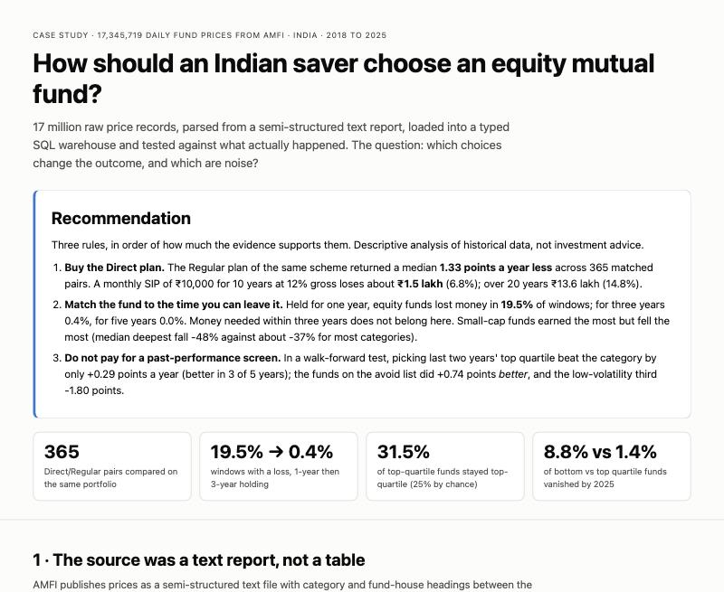
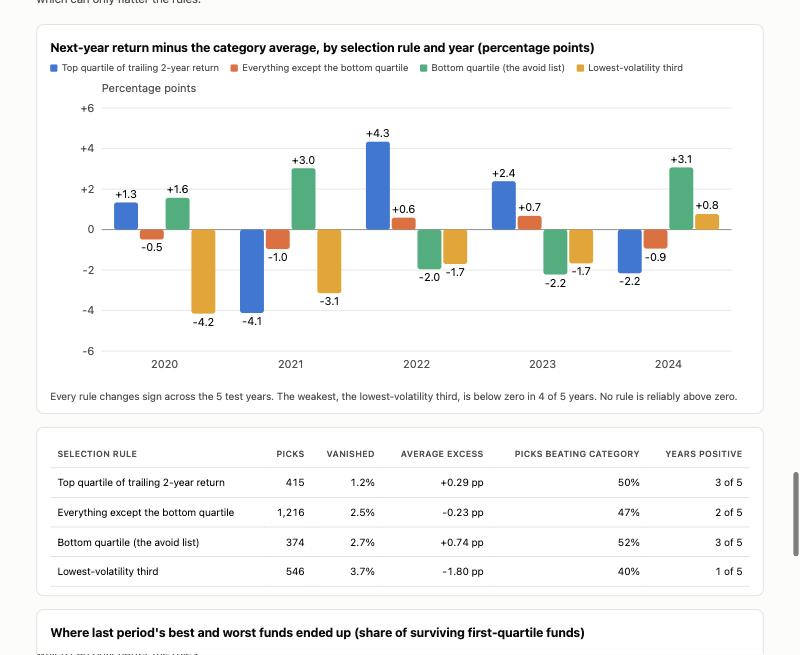
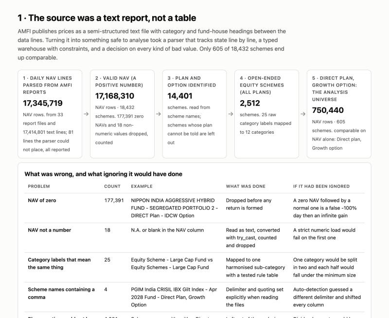

# Choosing an Indian equity mutual fund: what matters, what is noise

17.3 million daily fund prices from AMFI (2018 to 2025, 18,432 schemes), parsed from a text report into a SQL warehouse (DuckDB).

**[Open the interactive decision page](https://rahuljtom.github.io/india-mutual-fund-analytics/)**

> Descriptive analysis of historical public data, not investment advice.



## Three rules, ranked by strength of evidence

### 1. Buy the Direct plan
- **Evidence:** across 365 matched pairs, Regular returned a median **1.33 points a year less** than Direct (range 0.07 to 2.35).
- **In rupees:** a ₹10,000 monthly SIP at 12% gross loses about **₹1.5 lakh** over 10 years and ₹13.6 lakh over 20. The return is a scenario; only the gap is measured.

### 2. Match the fund to your holding period
- **Evidence:** equity funds lost money in **19.5%** of one-year windows, **0.39%** of three-year and **0.02%** of five-year windows.
- **So:** money needed within three years does not belong in equity. Small caps earned most (median 26.8% a year over 3 years) and fell most (median deepest fall -48%).

### 3. Do not pay for a past-performance screen
- **Evidence:** in a walk-forward test, last two years' top-quartile funds beat their category by only **+0.29** points a year (better in 3 of 5 years). The avoid list did +0.74 *better*; the low-volatility third -1.80.
- **Persistence:** 31.5% of top-quartile funds stayed top-quartile versus 25% by chance (p = 0.13, not distinguishable from luck).



## From a text report to 605 comparable schemes



| Problem | Count | Handling |
|---|---|---|
| NAV of zero (segregated portfolios) | 177,391 rows | Dropped; otherwise a false -100% day |
| NAV not a number | 18 rows | Converted with `try_cast`, counted |
| Same category, different labels | 25 labels → 12 | Mapped by a tested rule table |
| Plan or option unidentifiable | 4,031 schemes | Excluded, counted |
| Schemes that closed or merged | 8,391 of 12,242 | Kept in history so failures show |

Every line of the source is counted or rejected by reason ([`r03_parse_summary.csv`](outputs/tables/r03_parse_summary.csv)).

## How it was checked

- 37 tests on a synthetic history with hand-computed answers, mutation-checked.
- 35 headline numbers recomputed independently in pandas, including the backtest.
- SQL lint and tests on every push. Bugs found in real data (a comma in a scheme name, "Dividend Yield" read as a payout option) each have a test.

## Limits

One market regime (a 2020 crash, a strong 2021 to 2025). The backtest has five test years: it finds no reliable edge, which is not proof none exists. Medians for small categories are noisy. The benchmark is a proxy (median of 17 Nifty 50 index funds). Taxes, exit loads, fund size and holdings were not studied. AMFI's terms of use have not been reviewed here; check them before reuse.

## Reproduce

```bash
make setup && make download   # about 30 minutes, resumable
make build site check audit
```

Details: [methodology](docs/methodology.md) · [data dictionary](docs/data_dictionary.md) · [decision log](docs/decisions.md)
