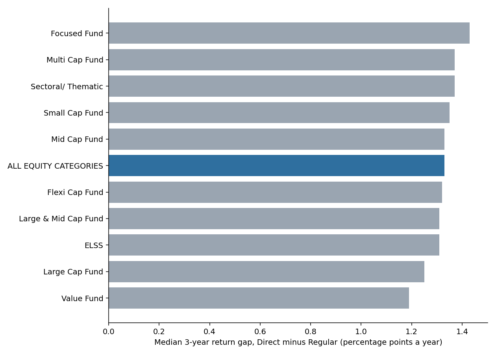

# India equity mutual funds: returns, drawdowns, cost and persistence

SQL analytics on 17.3 million daily NAV records from AMFI (the Association of Mutual Funds in India), 2018 to 2025,
covering 18,432 schemes. The question: **how do Indian equity fund categories compare on rolling returns, drawdowns and
cost, and does past outperformance within a category repeat?**

Built with DuckDB and plain SQL (11 numbered files, linted with SQLFluff), a Python parser for AMFI's semi-structured text
reports, 26 automated tests, and an independent pandas audit of the headline numbers.

> Descriptive analysis of historical public data, not investment advice. Past returns do not predict future returns.

## Recommendation up front

If a client asked which levers matter when choosing equity funds, this data says:

1. **Cost is the one edge that shows up in every category.** Across 365 matched scheme pairs, the Regular plan returned a
   median **1.3 percentage points a year less** than the Direct plan of the same scheme (range 0.07 to 2.35). Over three
   years at the median returns, that is about **3.3% less final wealth** for the same portfolio.
2. **Higher category returns came with disproportionate risk.** Small-cap funds had the highest median 3-year rolling
   return (26.8% a year at the median) but also the deepest median drawdown (-48%, against about -37% for most categories) and the lowest
   return per unit of volatility. Value and Mid Cap funds gave the best return per unit of risk (about 1.6).
3. **Avoid persistent laggards rather than chase past winners.** Top-quartile funds stayed top-quartile 31.5% of the time
   against 25% by chance, which is not statistically distinguishable from luck (p = 0.13). Bottom-quartile funds stayed
   bottom-quartile 38.7% of the time (p = 0.01).
4. **Survivorship flatters fund tables.** Of the schemes that ranked in the bottom quartile, 8.8% had no NAV by the end of
   2025 (closed, merged or re-coded), against 1.4% of top-quartile schemes.


## Findings

**Rolling 3-year returns, all windows ending 2021 to 2025** (`r05_rolling_by_category`, Direct/Growth schemes)

| Category | Schemes | Median | 10th to 90th percentile | Windows below 0% |
|---|---|---|---|---|
| Small Cap | 27 | 26.79% | 15.17% to 39.45% | 0.7% |
| Mid Cap | 33 | 23.72% | 14.59% to 32.75% | 0.1% |
| Large & Mid Cap | 29 | 20.35% | 13.40% to 27.40% | 0.0% |
| Flexi Cap | 32 | 18.18% | 11.77% to 26.58% | 0.0% |
| Large Cap | 36 | 16.39% | 11.54% to 22.40% | 0.0% |

The table shows five of the 11 reported categories; all are in `outputs/tables/`. 2021 to 2025 was a strong period for Indian
equities, so these levels should not be read as typical.

**Drawdowns** (`r06_drawdown_by_category`, schemes alive from January 2018 to December 2025)


The deepest drop for most categories is the March 2020 crash (about -36% to -37%, recovered in a median of about 230 to 265 days after
the trough). Small-cap and value funds were also hit by the 2018 to 2019 decline, so their peak-to-trough spans a median of
about 790 to 800 days against 40 to 137 days for the other categories. One Large Cap scheme had not regained its peak by December 2025
because its largest fall was in late 2024 to early 2025; "recovered" depends on the end date.

**Against a Nifty 50 index-fund proxy** (`r05_vs_benchmark`): the median Large Cap fund beat the median Nifty 50 index fund
on 72.5% of dates, by a median 0.5 points a year. The larger gaps for Small and Mid Cap (11.6 and 8.8 points) compare those
categories with a large-cap index, so they mostly show the size premium of this period, not manager skill.

**Does performance persist?** (`r08_*`; rank within category on one 3-year window, then the next)


Of 73 surviving first-quartile schemes, 23 were first-quartile again. The category-level repeat rates (0% to 67%) rest on
2 to 23 schemes each and should not be compared.

**Direct versus Regular** (`r09_direct_vs_regular`): the gap is positive in every category, between 1.2 and 1.4 points a year at
the median.



## How it was built

```
AMFI portal ─► download (33 windows of 90 days, resumable)
            ─► parse text report ─► gzip CSV (every line counted or rejected by reason)
            ─► DuckDB: stage as text ─► star schema (dim_amc, dim_category, dim_scheme, fact_nav)
            ─► quality report ─► analysis universe ─► ASOF-join look-backs
            ─► rolling returns, drawdowns, risk/return, persistence, plan pairs ─► outputs/tables, outputs/charts
```

| Practice | Where |
|---|---|
| Typed star schema with primary keys, foreign keys and CHECK constraints | `sql/02_dimensions.sql` |
| Every exclusion counted; duplicate and orphan checks | `sql/03_data_quality.sql`, `outputs/tables/r03_*` |
| ASOF joins for look-backs; stale data treated as missing, never carried forward | `sql/04_universe.sql`, `sql/05_rolling_returns.sql` |
| Window functions: `LAG`, running `MAX`, `NTILE`, `RANK`, percentiles | `sql/03` to `sql/09` |
| Parser, SQL and classification tests on a synthetic history with hand-computed answers | `tests/` (26 tests) |
| Independent recomputation of headline numbers in pandas (12 checks, all pass) | `scripts/audit_headlines.py` |
| CI: SQL lint and tests on every push | `.github/workflows/ci.yml` |
| Documented choices and definitions | `docs/` |

Real data found problems the test fixtures did not, and each now has a test: a scheme name containing a comma broke CSV
auto-detection; "Dividend Yield" funds were misread as dividend-payout schemes; AMFI uses "Equity Scheme" and "Equity Schemes"
for the same category and renamed others over time; headings without a separator were truncated.

## Data and quality

- **Source:** AMFI historical NAV report (portal.amfiindia.com), pulled 7 November 2026 for 1 January 2018 to 31 December 2025.
  110 MB compressed, 2.3 GB as text; not committed.
- 17,345,719 NAV rows staged; 17,168,310 kept. 177,391 rows (1.0%) were dropped for a NAV of zero (the examples checked were segregated portfolios); 18 for a
  non-numeric NAV. No duplicate keys and no orphan rows remain.
- The file includes schemes that later closed or merged (8,391 of the 12,242 schemes with a NAV in 2018 have no NAV in December 2025), so the
  history is not limited to survivors.

## Limitations

- **One market regime.** Eight years, with a crash in 2020 and a strong 2021 to 2025. Rolling windows overlap, and funds in a
  category hold similar stocks, so the window counts are not independent observations.
- **Small categories.** Medians and quartiles for categories of 8 to 30 schemes are noisy; categories below 8 are not reported.
- **Persistence uses one pair of periods** and is conditional on surviving to the end. The attrition table shows what this hides.
- **Benchmark is a proxy:** the median of 17 Direct/Growth Nifty 50 index funds, net of fund costs, not the index.
- **Latest category per scheme.** A scheme that changed category keeps its latest one for its whole history.
- **Direct versus Regular gap** is mostly, not only, the cost difference; paired plans can differ slightly in timing of NAV.
- **Not investigated:** taxes, exit loads, fund size, portfolio holdings and fees themselves (only their effect on NAV).
- AMFI's terms of use for this data have not been reviewed here; check them before reuse.

## Reproduce

```bash
make setup
make download   # about 30 minutes; resumable
make build      # parse and build the warehouse (under 2 minutes), export outputs/tables
make charts
make check      # SQL lint and tests
PYTHONPATH=src .venv/bin/python scripts/audit_headlines.py
```

Parameters (window length, as-of date, minimum category size) are in `src/mfa/pipeline.py` and stored in a `params` table, so
every query reads them from one place. Definitions are in `docs/methodology.md`, tables in `docs/data_dictionary.md`.
