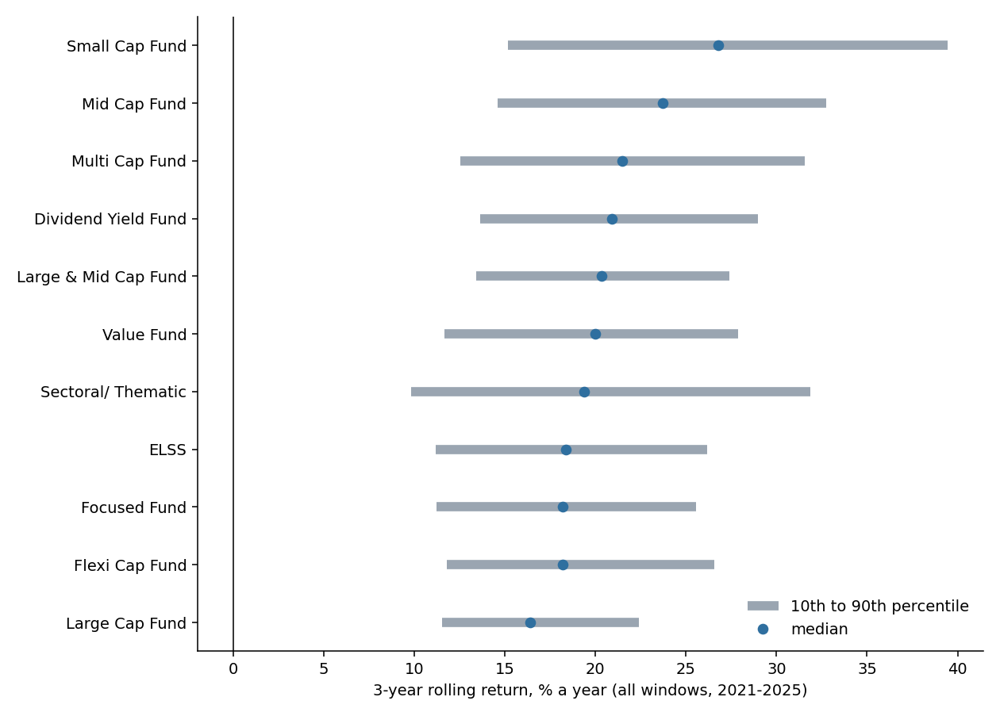
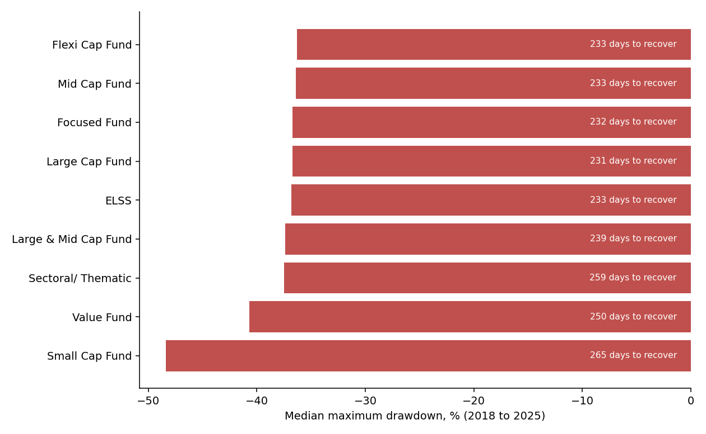
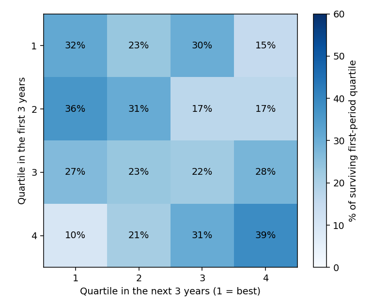

# India equity mutual funds: what actually matters when choosing one

An analysis of 17.3 million daily fund prices (NAVs) from AMFI, the Association of Mutual Funds in India, 2018 to 2025, covering
18,432 schemes. The source is a semi-structured text report, not a table. It was parsed, loaded into a typed SQL warehouse (DuckDB)
and used to answer one question: **which choices change the outcome for an equity fund investor, and which are noise?**

**[Open the decision page](docs/index.html)** (a single self-contained HTML file: download it or open it from a clone;
or enable GitHub Pages on the `/docs` folder to host it).

> Descriptive analysis of historical public data, not investment advice. Past returns do not predict future returns.


## The decision

Three rules, in order of how much the evidence supports them:

1. **Buy the Direct plan.** Across 365 matched scheme pairs, the Regular plan returned a median **1.33 percentage points a year less**
   than the Direct plan of the same scheme (range 0.07 to 2.35). A monthly SIP of ₹10,000 for 10 years at 12% gross loses about
   **₹1.5 lakh** (6.8%); over 20 years about ₹13.6 lakh (14.8%). The gross return is a scenario; only the gap comes from the data.
2. **Match the fund to the time you can leave it.** Held for one year, equity funds lost money in **19.5%** of windows; for three years
   0.39%, for five years 0.02% (2 windows in 9,665). Money needed within three years does not belong in equity funds. Small-cap funds
   earned the most (median 3-year return 26.8% a year) but fell the most (median deepest fall -48%, against about -37% for most categories).
3. **Do not pay for a past-performance screen.** In a walk-forward test, picking last two years' top-quartile funds beat the category by
   only +0.29 points a year (better in 3 of 5 years). The funds on the avoid list did +0.74 points *better*, and the low-volatility third
   -1.80 points.


## The source was a text report

AMFI publishes prices as a text file with category and fund-house headings between the data lines, in 90-day windows. Turning it into
something safe to analyse (`outputs/tables/r13_*.csv`):


| Problem | Count | What was done | If ignored |
|---|---|---|---|
| NAV of zero (segregated portfolios) | 177,391 rows | Dropped before any return is formed | A false -100% day then an infinite gain |
| NAV not a number (`N.A.`) | 18 rows | Read as text, converted with `try_cast`, counted | A strict numeric load fails on the first |
| Same category under different labels | 25 labels → 12 categories | Mapped by a tested rule table | One category split in two, each half under the minimum size |
| Scheme names containing a comma | 4 schemes | Delimiter and quoting set explicitly | Auto-detection shifted every column |
| Plan or option not identifiable | 4,031 schemes | Left out of the universe, counted | Dividend payouts would read as losses against Growth NAVs |
| Schemes that closed or merged | 8,391 of 12,242 alive in 2018 | Kept in the history, reported | A list of today's funds hides the failures |

Every text line is counted or rejected by reason (`r03_parse_summary.csv`: 17,414,801 lines, 81 the parser could not place, all reported).

## Findings in more detail

**Rolling 3-year returns, all windows ending 2021 to 2025** (`r05_rolling_by_category`, Direct/Growth schemes)

| Category | Schemes | Median | 10th to 90th percentile | Windows below 0% |
|---|---|---|---|---|
| Small Cap | 27 | 26.79% | 15.17% to 39.45% | 0.7% |
| Mid Cap | 33 | 23.72% | 14.59% to 32.75% | 0.1% |
| Large & Mid Cap | 29 | 20.35% | 13.40% to 27.40% | 0.0% |
| Flexi Cap | 32 | 18.18% | 11.77% to 26.58% | 0.0% |
| Large Cap | 36 | 16.39% | 11.54% to 22.40% | 0.0% |

Five of the 11 reported categories; all are in `outputs/tables/`. 2021 to 2025 was a strong period for Indian equities, so these levels
should not be read as typical.



**Drawdowns** (`r06_drawdown_by_category`, schemes alive from January 2018 to December 2025). The deepest drop for most categories is the
March 2020 crash (about -36% to -37%, recovered in a median of about 230 to 265 days after the trough). Small-cap and value funds were also
hit by the 2018 to 2019 decline, so their peak-to-trough spans a median of about 790 to 800 days against 40 to 137 days for the others.
Value and Mid Cap funds gave the best return per unit of volatility (about 1.6); Small Cap the lowest (1.36).



**Against a Nifty 50 index-fund proxy** (`r05_vs_benchmark`): the median Large Cap fund beat the median Nifty 50 index fund on 72.5% of dates,
by a median 0.5 points a year. The larger gaps for Small and Mid Cap (11.6 and 8.8 points) compare those categories with a large-cap index, so
they mostly show the size premium of this period, not manager skill.

**Does performance persist?** (`r08_*`) Of 73 surviving top-quartile funds, 23 (31.5%) were top-quartile again, against 25% by chance
(one-sided p = 0.13, not distinguishable from luck). Of 62 surviving bottom-quartile funds, 24 (38.7%) stayed at the bottom (p = 0.01).
8.8% of bottom-quartile funds had no price by the end of 2025 against 1.4% of top-quartile ones, so fund tables built from today's funds
look better than the funds people actually held.



## How it was built

```
AMFI portal ─► download (33 windows of 90 days, resumable)
            ─► parse text report ─► gzip CSV (every line counted or rejected by reason)
            ─► DuckDB: stage as text ─► star schema (dim_amc, dim_category, dim_scheme, fact_nav)
            ─► quality report ─► analysis universe ─► ASOF-join look-backs, month-end panel
            ─► rolling returns, drawdowns, risk/return, persistence, plan pairs, backtest, holding periods, cost drag
            ─► outputs/tables ─► docs/index.html (the decision page)
```

| Practice | Where |
|---|---|
| Typed star schema with primary keys, foreign keys and CHECK constraints | `sql/02_dimensions.sql` |
| Every exclusion counted; duplicate and orphan checks; mess catalogue and funnel | `sql/03_data_quality.sql`, `sql/13_data_mess.sql` |
| ASOF joins for look-backs; stale data treated as missing, never carried forward | `sql/04_universe.sql`, `sql/05_rolling_returns.sql` |
| Walk-forward backtest with no look-ahead and survivorship reported | `sql/11_backtest.sql` |
| Holding-period odds and a rupee cost illustration | `sql/12_cost_and_horizon.sql` |
| Window functions: `LAG`, running `MAX`, `NTILE`, `RANK`, percentiles | `sql/03` to `sql/12` |
| 37 tests: parser, SQL and classification on a synthetic history with hand-computed answers, mutation-checked | `tests/` |
| Independent recomputation of 35 headline numbers in pandas (including the backtest and holding periods, reimplemented from scratch) | `scripts/audit_headlines.py` |
| CI: SQL lint and tests on every push | `.github/workflows/ci.yml` |
| Documented choices and definitions | `docs/` |

Real data found problems the test fixtures did not, and each now has a test: a scheme name containing a comma broke CSV auto-detection;
"Dividend Yield" funds were misread as dividend-payout schemes; AMFI uses "Equity Scheme" and "Equity Schemes" for the same category and renamed
others over time; headings without a separator were truncated.

## Data and quality

- **Source:** AMFI historical NAV report (portal.amfiindia.com), pulled 7 November 2026 for 1 January 2018 to 31 December 2025.
  110 MB compressed, 2.3 GB as text; not committed.
- 17,345,719 NAV rows staged; 17,168,310 kept. 177,391 rows (1.0%) were dropped for a NAV of zero; 18 for a non-numeric NAV. No duplicate
  keys and no orphan rows remain.
- The analysis universe is 605 open-ended equity schemes in Direct plan, Growth option (750,440 NAV rows), plus Nifty 50 index funds as the
  benchmark.

## Limitations

- **One market regime.** Eight years, with a crash in 2020 and a strong 2021 to 2025. Rolling and holding windows overlap, and funds in a
  category hold similar stocks, so the window counts are not independent observations. A multi-year bear market would lengthen the holding
  period needed to avoid a loss.
- **The backtest has five test years.** It shows no reliable edge for the four rules tested; it cannot prove that no edge exists. Picks that
  vanished before the end of the test year are excluded from the excess return, which can only flatter a rule.
- **Small categories.** Medians and quartiles for categories of 8 to 30 schemes are noisy; categories below 8 are not reported.
- **Benchmark is a proxy:** the median of 17 Direct/Growth Nifty 50 index funds, net of fund costs, not the index.
- **Latest category per scheme.** A scheme that changed category keeps its latest one for its whole history.
- **The Direct versus Regular gap** is mostly, not only, the cost difference; paired plans can differ slightly in timing of NAV.
- **Not investigated:** taxes, exit loads, fund size, portfolio holdings and fees themselves (only their effect on NAV).
- **The rupee illustration** uses a gross return scenario (8% to 15%), not a forecast.
- AMFI's terms of use for this data have not been reviewed here; check them before reuse.

## Reproduce

```bash
make setup
make download   # about 30 minutes; resumable
make build      # parse and build the warehouse (under 2 minutes), export outputs/tables
make charts
make site       # build docs/index.html
make check      # SQL lint and tests
make audit      # independent pandas recomputation
```

Parameters (window length, as-of date, minimum category size) are in `src/mfa/pipeline.py` and stored in a `params` table, so
every query reads them from one place. Definitions are in `docs/methodology.md`, tables in `docs/data_dictionary.md`.
